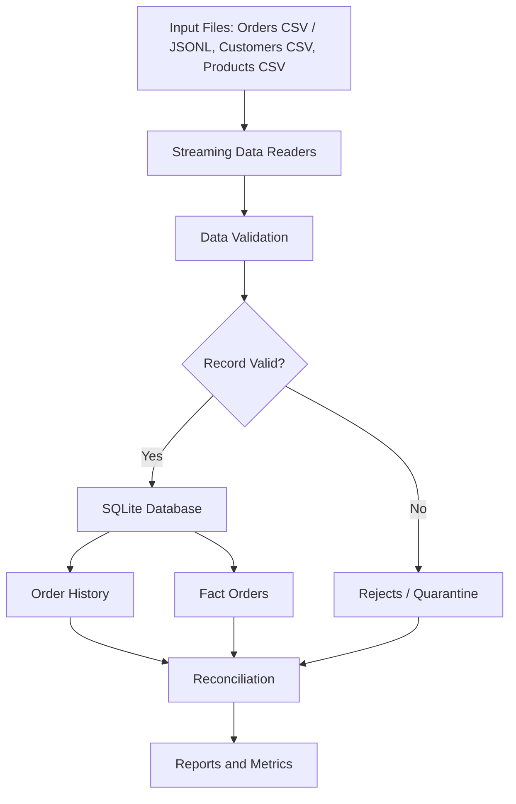

# OrderFlow – High-Performance Data Pipeline

A Python-based, SQLite-powered data engineering pipeline designed to process large-scale order event datasets with streaming ingestion, validation, reconciliation, and reporting.

## 🚀 Project Overview

OrderFlow ingests large order-event files (CSV or JSON Lines) along with customer and product reference datasets into SQLite.

It supports chunk-based processing, data validation, quarantine management, resumable loads, late-arriving event handling, and reconciliation against expected results.

## 🏗️ System Architecture




## ✨ Key Features

- Streaming and chunk-based data ingestion
- CSV and JSONL data processing
- SQLite database integration
- Data validation and error handling
- Duplicate event detection
- Resumable data loading
- Late-arriving event handling
- Order reconciliation and reporting
- Structured logging and run metrics
- Automated unit testing

## 🛠️ Technology Stack

- **Language:** Python 3.9+
- **Database:** SQLite
- **Data Formats:** CSV, JSON Lines
- **Testing:** Python unittest
- **Version Control:** Git and GitHub

## 📂 Project Structure

```text
orderflow-data-pipeline/
│
├── data/
│   └── sample/
├── docs/
├── output/
├── pipeline/
│   ├── cli.py
│   ├── config.py
│   ├── db.py
│   ├── generator.py
│   ├── loader.py
│   ├── readers.py
│   ├── reconcile.py
│   ├── reports.py
│   └── schema.py
│
├── tests/
├── .gitignore
├── Makefile
├── README.md
├── requirements.txt
└── test_run.txt
```

## ⚙️ Installation

Clone the repository:

```bash
git clone https://github.com/kgmbharadwaj/orderflow-data-pipeline.git
cd orderflow-data-pipeline
```

Create a virtual environment:

```bash
python -m venv venv
```

Activate it on Windows:

```bash
venv\Scripts\activate
```

Install dependencies:

```bash
pip install -r requirements.txt
```

## ▶️ Running the Project

### 1. Run unit tests

```bash
python -m unittest discover -s tests -t . -v
```

### 2. Generate sample data

```bash
python -m pipeline generate --out data/generated --rows 100000 --seed 42
```

### 3. Load generated data into SQLite

```bash
python -m pipeline load --db wh.db --customers data/generated/customers.csv --products data/generated/products.csv --orders data/generated/orders.csv
```

### 4. Run reconciliation

```bash
python -m pipeline reconcile --db wh.db --orders data/generated/orders.csv --expected data/generated/expected_summary.json --labels data/generated/orders_labels.csv
```

### 5. Run the benchmark

```bash
python -m pipeline benchmark --rows 100000
```

### 6. Generate reports

```bash
python -m pipeline report --db wh.db
```

## 📊 Performance Benchmarks

The following results were observed during local benchmark runs:

| Metric | 100K rows | 500K rows |
|---|---:|---:|
| Rows processed | 100,000 | 500,000 |
| Rows loaded | 95,148 | 475,733 |
| Rows rejected | 4,852 | 24,267 |
| Rows per second | 10,831 | 10,620 |
| Peak RSS memory | 47 MB | 56.7 MB |
| Reconciliation | PASS | PASS |

*Benchmark results are environment-dependent and reflect observed local runs.*

## 🧪 Testing

The project includes automated tests covering:

- Data validation
- Customer and product references
- Currency and order status
- Timestamp normalization
- Duplicate detection
- Quantity and price boundaries
- Order update validation

**Test result:** 45 tests passed.

## 🔍 Data Quality and Reconciliation

The reconciliation process compares generated expectations with actual database records.

It checks:

- Total source records
- Valid and rejected records
- Distinct valid orders
- Order line totals
- Duplicate records
- Orphan customer and product references
- Per-line outcome mismatches

**Latest observed reconciliation result: PASS**
## 📚 Documentation

- [System Architecture](docs/architecture.md)
- [Data Dictionary](docs/DATA_DICTIONARY.md)
- [Design and Trade-offs](docs/DESIGN.md)
## 🔮 Future Enhancements

- Integrate Apache Airflow for workflow orchestration.
- Implement parallel data processing.
- Migrate SQLite storage to PostgreSQL.
- Add a real-time monitoring dashboard.
- Integrate cloud storage for large datasets.
## 🎯 Project Objective

To demonstrate practical data engineering concepts through a reliable, scalable, and testable order-processing pipeline.

## 👨‍💻 Author

**K. Gnana Mani Bharadwaj**

GitHub: [@kgmbharadwaj](https://github.com/kgmbharadwaj)

---

If you find this project useful, feel free to explore the repository and its implementation.
